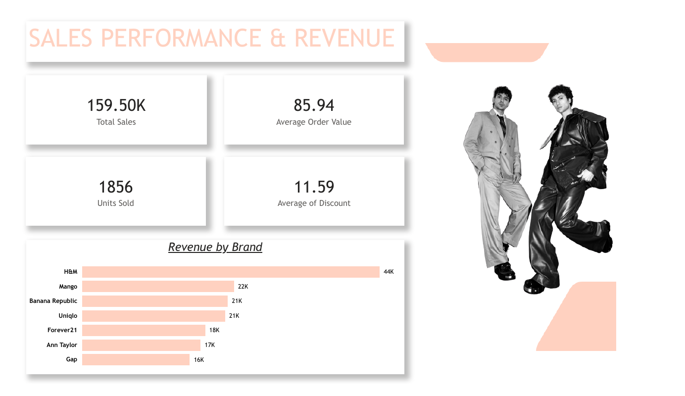
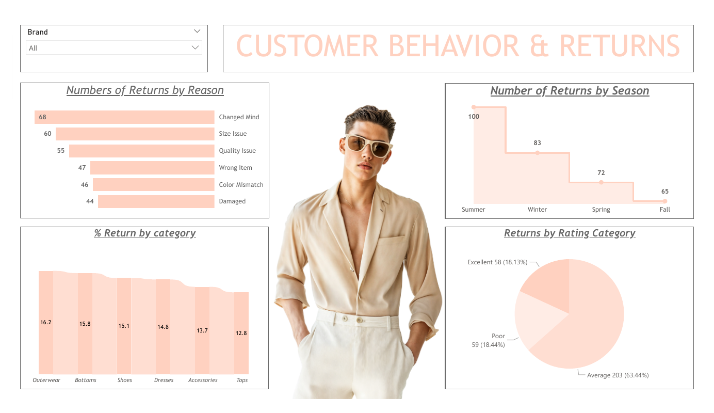
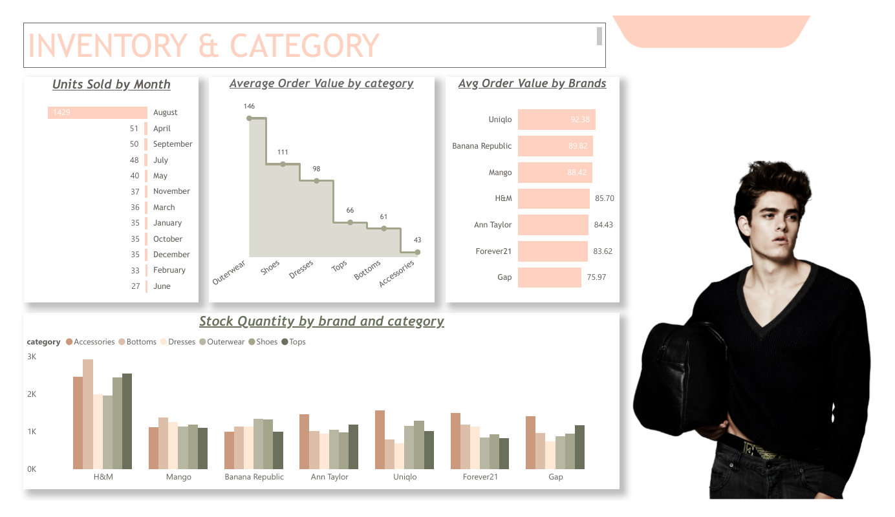
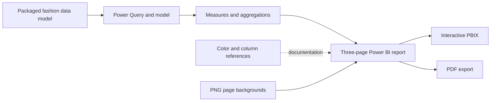

# Fashion Data Analysis

A Power BI report for exploring fashion retail sales, returns, inventory, and category performance. The repository includes the editable PBIX report, a PDF export, page background images, and reference workbooks for field definitions and colors.

## Dashboard preview

### Sales performance and revenue



### Customer behavior and returns



### Inventory and category



## Report highlights

- Summarizes 159.50K in sales, 1,856 units sold, and an average order value of 85.94 in the packaged report model.
- Compares revenue and average order value across seven fashion brands.
- Breaks down 320 returns by reason, season, product category, and customer-rating group.
- Tracks monthly units sold and stock quantity across six product categories.

## Features

- Sales summary with total sales, average order value, units sold, average discount, and revenue by brand.
- Return analysis by reason, season, product category, and rating group.
- Inventory and category views for monthly units sold, average order value, and stock quantity.
- Brand filter for interactive report exploration.
- PDF export for viewing the report without Power BI Desktop.

## Technology stack

- Microsoft Power BI Desktop (`.pbix`)
- Power Query and the Power BI data model packaged in the report
- Microsoft Excel reference workbooks (`.xlsx`)
- PDF and PNG report assets

## Architecture



## Installation and use

### Requirements

- Windows with [Power BI Desktop](https://powerbi.microsoft.com/desktop/) to edit or interact with the PBIX file.
- A PDF reader to view the static export.
- Excel or another compatible spreadsheet application to view the reference workbooks.

### Open the report

1. Clone the repository:

   ```bash
   git clone https://github.com/Puneeth0106/fashion-data-analysis.git
   cd fashion-data-analysis
   ```

2. Open `powerbi/Fashion-Dataset.pbix` in Power BI Desktop.
3. Use the brand filter and report pages to explore the packaged model.

For a static preview, open `docs/Fashion-Dataset.pdf`.

## Configuration

The current report packages its data model inside the PBIX file. No environment variables are required. `.env.example` documents a placeholder path for a future external-file setup, but the current Power BI query does not read that file.

If the source query is changed in Power BI Desktop, update its data-source path in Power Query and refresh the report before saving.

## Project structure

```text
.
├── assets/
│   └── page-backgrounds/      # PNG backgrounds used by report pages
├── docs/
│   ├── screenshots/           # GitHub-friendly dashboard previews
│   └── Fashion-Dataset.pdf    # Static three-page report export
├── powerbi/
│   └── Fashion-Dataset.pbix   # Editable Power BI report and packaged model
├── reference/
│   ├── Colour-Code.xlsx       # Report color palette
│   └── Column-Definitions.xlsx# Dataset field descriptions
├── .env.example
├── .gitattributes
├── .gitignore
└── README.md
```

## Known limitations

- Power BI Desktop is required for full interaction and report editing, and it is available only on Windows.
- The PDF is a static export and does not support filters or drill-down interactions.
- The original row-level source file is not included separately; the available data model is packaged in the PBIX file.
- Refresh against a replacement external data source was not tested.
- The report was inspected statically in this environment, but interactive Power BI behavior was not tested because Power BI Desktop was unavailable.

